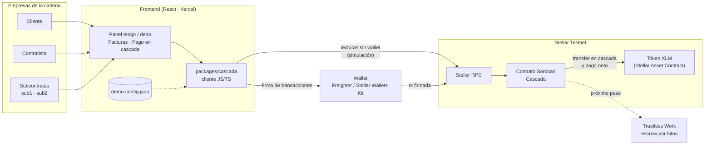
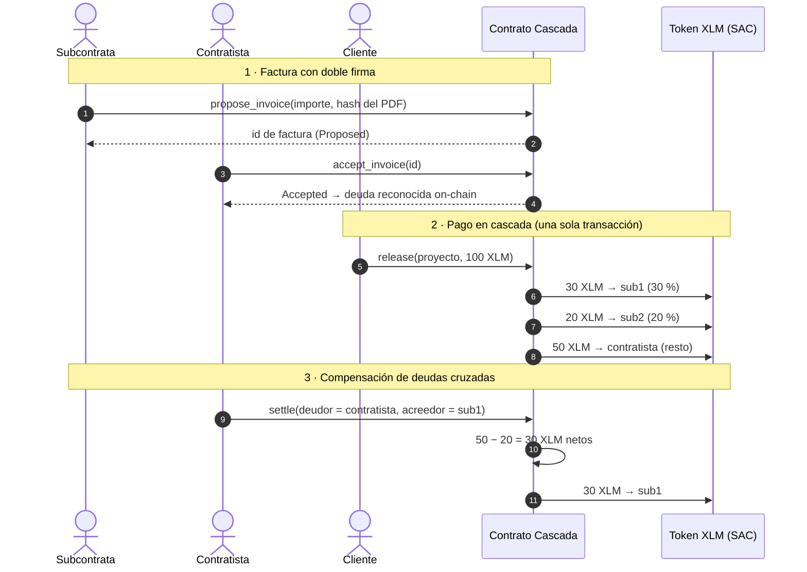

# Arquitectura

Cascada registra facturas con doble firma, reparte pagos en cascada y compensa deudas cruzadas entre empresas de una cadena de subcontratación, todo en un contrato Soroban en **Stellar Testnet**.

## Visión general

| Pieza | Qué hace |
|---|---|
| **Frontend (React)** | Panel tengo/debo, facturas y pago en cascada. Muestra los datos sin conectar wallet. |
| **`packages/cascada`** | Cliente JS/TS del contrato. Lee la interfaz del contrato desde la red (`contract.Client.from`). |
| **Wallet** | Freighter / Stellar Wallets Kit. Firma solo las acciones (proponer, aceptar, pagar, compensar). |
| **Stellar RPC** | Simula las lecturas y envía las transacciones firmadas. |
| **Contrato Cascada** | Guarda proyectos, facturas y deudas; ejecuta el reparto y la compensación. |
| **Token XLM (SAC)** | El contrato mueve los fondos con la interfaz de token estándar (SEP-41). |
| **Trustless Work** | Siguiente paso: escrow por hitos antes del `release`. |

## Flujo principal

1. **Doble firma**: quien cobra propone la factura con el SHA-256 del PDF; solo cuando quien paga la acepta pasa a ser deuda on-chain.
2. **Pago en cascada**: un único `release` reparte el dinero entre todas las subcontratas según su porcentaje, de forma atómica (o cobran todas o ninguna).
3. **Compensación**: si dos empresas se deben dinero mutuamente, `settle` cancela ambas deudas y solo se transfiere la diferencia.

Detalles del contrato desplegado: [CONTRATO.md](CONTRATO.md).
