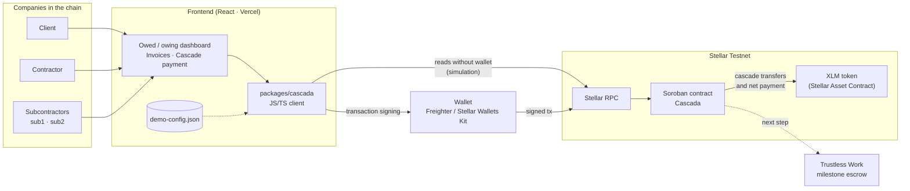
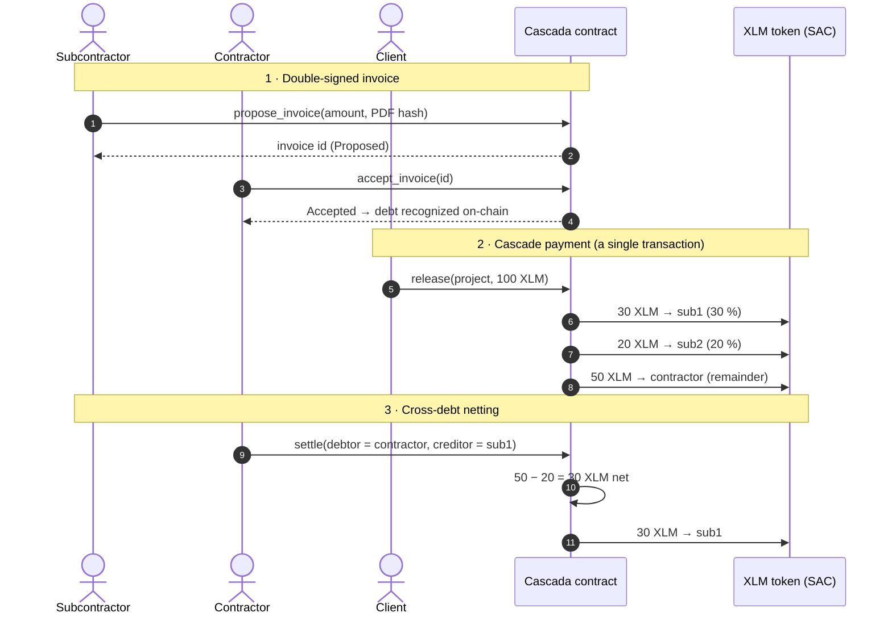

# Architecture

Cascada records double-signed invoices, splits payments down the subcontracting chain and nets out cross-debts between companies — all in a Soroban smart contract on **Stellar Testnet**.

## Overview

| Component | What it does |
|---|---|
| **Frontend (React)** | Owed/owing dashboard, invoices and cascade payment. Shows data without connecting a wallet. |
| **`packages/cascada`** | JS/TS client for the contract. Reads the contract interface from the network (`contract.Client.from`). |
| **Wallet** | Freighter / Stellar Wallets Kit. Signs only the actions (propose, accept, pay, settle). |
| **Stellar RPC** | Simulates reads and submits signed transactions. |
| **Cascada contract** | Stores projects, invoices and debts; executes the split and the netting. |
| **XLM token (SAC)** | The contract moves funds through the standard token interface (SEP-41). |
| **Trustless Work** | Next step: milestone escrow before `release`. |

## Main flow

1. **Double signature**: the party getting paid proposes the invoice with the SHA-256 hash of the PDF; it only becomes an on-chain debt once the payer accepts it.
2. **Cascade payment**: a single `release` splits the money among all subcontractors according to their share, atomically (either everyone gets paid or no one does).
3. **Netting**: if two companies owe each other money, `settle` cancels both debts and only the difference is transferred.

Deployed contract details: [CONTRATO.md](CONTRATO.md).
